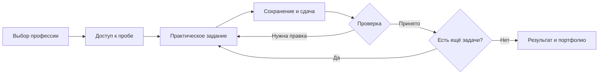

# ПРОБА / PROBA
### Product, Business & System Analysis Portfolio

**ПРОБА** — продукт для знакомства с IT-профессиями через последовательность практических задач, проверку решений, исправления и итоговое портфолио. Вместо теста «какая профессия мне подходит» пользователь пробует выполнять характерную работу в учебно-рабочей симуляции.

**Автор проекта:** Ярослав Солодков · **Роль:** Product Owner / Business & System Analysis · **Стадия:** бета.  
**Контекст:** самостоятельный проект; разработка с применением AI-assisted инструментов. Полный исходный код остаётся приватным.

---

## Что показывает этот репозиторий

Это **отдельное портфолио для работодателей**, а не открытая копия приложения. Здесь собраны обезличенные и сокращённые артефакты проектирования:

| Направление | Материал | Демонстрируемый навык |
|---|---|---|
| Product discovery | [Продуктовый кейс](docs/01-product-case.md) | Проблема, гипотеза, пользовательская ценность, MVP |
| Business Analysis | [Требования и процессы](docs/02-requirements-and-processes.md) | User stories, acceptance criteria, AS-IS/TO-BE |
| System Analysis | [Архитектура и взаимодействия](docs/03-system-design.md) | Компоненты, интеграции, статусы, границы доверия |
| Data Analysis / SQL | [Модель данных и SQL](docs/04-data-and-sql.md) | ER-модель, PostgreSQL, когорты, качество метрик |
| QA / Acceptance | [Тест-дизайн](docs/05-quality-assurance.md) | Негативные сценарии, идемпотентность, риск-ориентированная приёмка |
| Decision-making | [Решения и риски](docs/06-decisions-and-risks.md) | Trade-offs, change impact analysis, приоритизация |
| Personal contribution | [Мой вклад и ограничения](docs/07-contribution-and-evidence.md) | Ответственность, проверяемость, честная оценка результатов |

**Быстрый маршрут для интервью (5–10 минут):** [кейс](docs/01-product-case.md) → [требования](docs/02-requirements-and-processes.md) → [системная схема](docs/03-system-design.md) → [QA](docs/05-quality-assurance.md).

## Пример основного пользовательского пути

Схема упрощена. В реализации выделены версии контента, серверное управление прогрессом, фоновые проверки и сохранение истории сдач.

## Технологический контекст

`TypeScript` · `React / Next.js` · `NestJS / Fastify` · `PostgreSQL` · `Drizzle` · `Docker` · `pnpm / Turborepo` · `AI evaluator adapters`

Приватный проект организован как монорепозиторий с web, API, worker, изолированным runner и общими пакетами контрактов. Портфолио фокусируется на **анализе и проектировании**, а не на заявлении личного авторства всех исходников.

## Ключевые проектные принципы

- **Server-authoritative progression:** только сервер определяет доступную задачу и успешное завершение.
- **Версионирование:** опубликованные задания, сдачи и результаты оценки сохраняют историю.
- **Идемпотентность:** повторные операции не должны дублировать эффект.
- **Deterministic-first:** формальные правила проверяются до содержательной AI-оценки.
- **Security by design:** права доступа, приватность результатов, изоляция запуска пользовательского кода.
- **Раздельные gates:** успешные технические тесты сами по себе не означают готовности нового контента к публичному выпуску.

## Статус и границы достоверности

Работающая бета и инженерные кандидаты на расширение продукта — **не одно и то же**. Я не приравниваю локальные или синтетические проверки к независимому подтверждению продуктовых метрик, AI-качества или production-readiness.

Этот репозиторий:
- **не содержит** секретов, данных пользователей, полного исходного кода или закрытых критериев оценки;
- **не заявляет** выдуманных KPI, количества клиентов или подтверждённых финансовых результатов;
- использует **упрощённые диаграммы и демонстрационные SQL-запросы**, а не конфигурации production-среды;
- подготовлен по материалам приватного `suungenius/probav2` (ревизия и документы осмотрены 20.11.2026).

Код и существенная часть материалов создавались с использованием AI-assisted разработки, включая Codex. Мой вклад — постановка задач, продуктовые решения, анализ требований, организация разработки и проверка результатов. Подробнее — [роль и доказательства](docs/07-contribution-and-evidence.md).

---

**Описание для резюме:**  
*Самостоятельно развиваю ПРОБУ — платформу практических симуляций IT-профессий. Формулировал продуктовые и функциональные требования, проектировал пользовательские сценарии и модель прохождения, анализировал API/БД, организовывал тестирование и приёмку с применением AI-assisted разработки.*