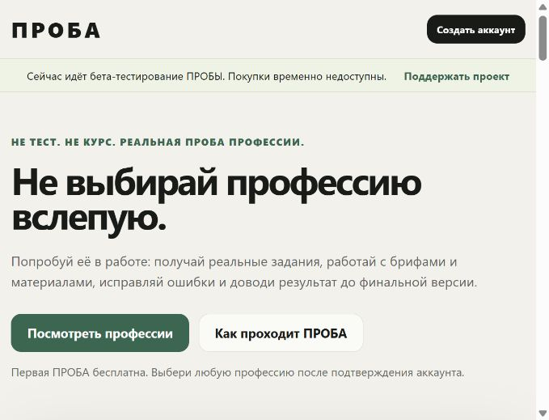
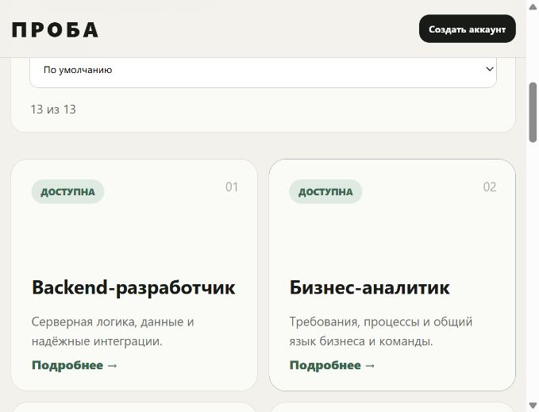
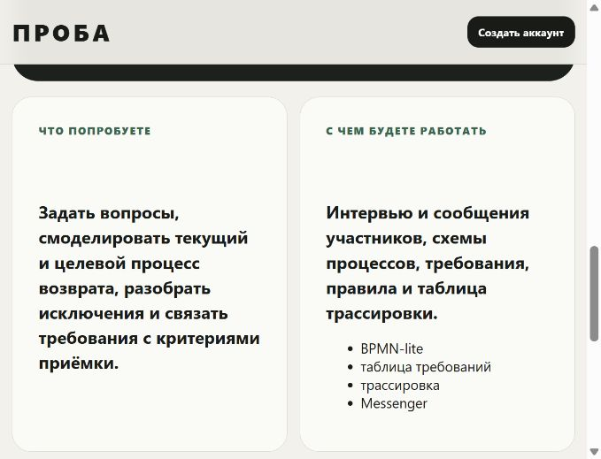

# ПРОБА · портфолио бизнес- и системного аналитика

ПРОБА помогает попробовать IT-профессию до выбора обучения или карьерного направления. Пользователь выполняет связанный рабочий кейс, получает обратную связь, вносит правки и может сохранить результат в портфолио.

**Ярослав Солодков, автор проекта.** Отвечаю за продуктовую постановку, требования, пользовательские сценарии, приоритеты и приёмку изменений. При реализации и подготовке тестов использовал AI-инструменты, включая Codex. [Мой вклад и основания для утверждений](docs/07-contribution-and-evidence.md).

## Кейс для собеседования

**Как защитить прохождение от повторной активации?** При нестабильном соединении пользователь может нажать «Начать» повторно. Если команда приходит с новым ключом, одной идемпотентности запроса недостаточно. На сервере проверяется существующее прохождение той же версии, а создание нового прохождения и использование права доступа происходят в одной транзакции.

[Требование и критерии приёмки](docs/02-requirements-and-processes.md) · [Анализ изменения](docs/06-decisions-and-risks.md) · [Негативные сценарии](docs/05-quality-assurance.md)

## Материалы проекта

| Материал | Что разобрано |
|---|---|
| [Продуктовый кейс](docs/01-product-case.md) | Для кого создан сервис, какую гипотезу он проверяет и как измерить результат |
| [Требования и процессы](docs/02-requirements-and-processes.md) | AS-IS / TO-BE, бизнес-правила, user stories и проверяемые критерии |
| [Системное проектирование](docs/03-system-design.md) | Компоненты, контракты HTTP, асинхронная проверка и внешняя интеграция |
| [Модель данных и SQL](docs/04-data-and-sql.md) | ER-диаграмма, ограничения PostgreSQL, когорты и число попыток |
| [Тестирование и приёмка](docs/05-quality-assurance.md) | Трассировка требований до сценариев и результаты проверок |
| [Решения и риски](docs/06-decisions-and-risks.md) | Влияние изменения на контракты, данные и регрессию |

## Открытая бета

Скриншоты открытых страниц от 20 ноября 2026 года. В каталоге отображались **13 профессий**. На главной странице действовало уведомление о бета-тестировании и временной недоступности покупок.

| [Главная](https://itproba.ru/) | [Каталог](https://itproba.ru/professions) | [Профессия «Бизнес-аналитик»](https://itproba.ru/professions/business-analyst) |
|---|---|---|
|  |  |  |
| Посетитель знакомится с форматом и переходит к выбору профессии. | Сравнивает направления по карточкам. | Видит, какие задачи будет решать и с какими материалами работать. |

Браузерная проверка охватила путь до страницы профессии без учётной записи. Данные о прохождениях, качество обратной связи ИИ и продуктовые метрики требуют отдельных подтверждений. [Границы доказательств](docs/07-contribution-and-evidence.md).

**Стек проекта:** Next.js и React · NestJS и Fastify · TypeScript · PostgreSQL и Drizzle · pg-boss · Docker.
