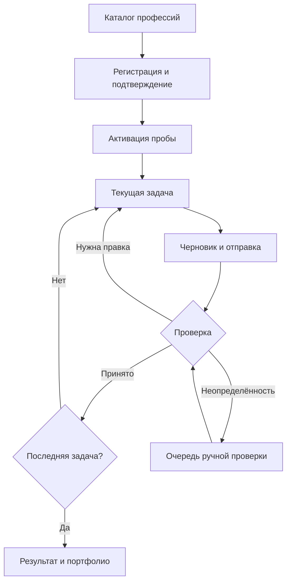

# Бизнес-анализ: требования и процессы

Документ — **санитизированное представление требований** для демонстрации аналитических навыков. Он не является полной публичной спецификацией приватного продукта.

## AS-IS / TO-BE

**AS-IS (обобщённая проблема):** человек получает сведения о работе из описаний и роликов; проверить реальные действия, ошибки и исправления в единой среде затруднительно.

**TO-BE:** человек проходит связанный рабочий сценарий с заданиями, проверками, исправлениями и сохраняемым результатом.

Диаграмма намеренно упрощена: не показывает все технические и исключительные статусы.

## Матрица функциональных требований

| ID | Требование | Приоритет | Приёмка |
|---|---|---|---|
| FR-01 | Пользователь видит каталог доступных профессий | Must | Каталог содержит только разрешённые к показу версии |
| FR-02 | Доступ к заданиям требует подтверждённого аккаунта | Must | Неподтверждённый аккаунт не начинает прохождение |
| FR-03 | Активация проверяет право доступа и лимит активных проб | Must | Повтор команды не создаёт второе прохождение |
| FR-04 | Черновик сохраняется на сервере с контролем ревизии | Must | Устаревшее сохранение не затирает новую версию |
| FR-05 | Сдача создаёт неизменяемую попытку | Must | История предыдущих сдач остаётся доступной |
| FR-06 | Сначала выполняются формальные проверки, затем необходимая экспертная оценка | Must | Нарушение жёсткого условия нельзя компенсировать красивым текстом LLM |
| FR-07 | Следующая задача открывается только после разрешённого завершения текущей | Must | Клиент не может самостоятельно изменить позицию |
| FR-08 | Будущие задания недоступны для редактирования | Must | Попытка обращения без права доступа отклоняется |
| FR-09 | Завершённая проба сохраняет историю и результаты | Must | Повторный просмотр не меняет состояние работы |
| FR-10 | Неуверенная оценка не превращается в автоматическое одобрение | Must | Сохраняется возможность ручного рассмотрения |

## Нефункциональные требования

| Категория | Требование / проверяемый принцип |
|---|---|
| Целостность | Атомарные переходы текущей задачи и фиксации результатов |
| Безопасность | Проверка владельца, запрет доступа к чужим заданиям, изоляция исполнения кода |
| Наблюдаемость | Логи ошибок и диагностируемые состояния фоновых проверок |
| Надёжность | Идемпотентность повторённых пользовательских и системных команд |
| Приватность | Не переносить текст сдач и контактные данные в продуктовую аналитику |
| Совместимость | Опубликованный контент и результаты привязаны к конкретным версиям |

## Примеры user stories и acceptance criteria

**US-01 — сохранение черновика.** Как пользователь, я хочу восстановить работу после перезагрузки страницы, чтобы не вводить её повторно.

- **Given** у пользователя активная проба и текущая задача;
- **When** он сохраняет черновик с актуальной ревизией;
- **Then** сервер подтверждает новую ревизию и возвращает сохранённое содержимое.
- **Negative:** устаревшая ревизия отклоняется без перезаписи.

**US-02 — защита от повторной сдачи.** Как пользователь, я хочу безопасно повторить запрос после сетевого сбоя.

- **Given** запрос сдачи уже обработан;
- **When** тот же идентификатор операции поступает снова с тем же содержимым;
- **Then** сервер возвращает прежний результат без дублирования попытки.
- **Negative:** тот же идентификатор с другим содержимым не считается той же операцией.

**US-03 — ограничение доступа.** Как пользователь, я должен видеть только свои материалы и достижения.

- Обращение к чужому прохождению или закрытой будущей задаче не возвращает защищённое содержимое.

## Неоднозначности, требующие отдельного согласования

- Как различать временную недоступность внешнего оценщика и содержательную ошибку ответа?
- Какие метрики считать продуктовой конверсией и на какой когорте?
- Какие материалы допустимо переносить между заданиями?
- Что считать основанием для ручного пересмотра результата?

Это примеры аналитических вопросов. Часть решений закреплена внутренними спецификациями, здесь показана логика постановки задачи без публикации закрытых правил.