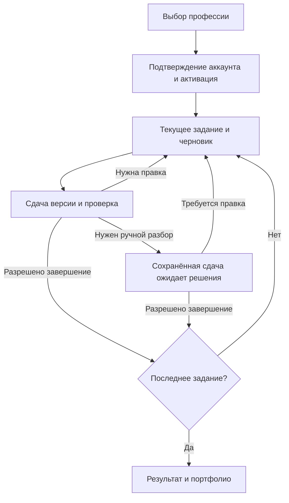

# Требования и процессы

## AS-IS и TO-BE

AS-IS — обобщённый сценарий до использования ПРОБЫ. Человек смотрит описания профессий, сопоставляет разрозненные примеры и сам решает, достаточно ли этого для выбора направления. Это рабочая гипотеза о пользовательском пути.

TO-BE — после выбора профессии человек получает связанный кейс, выполняет текущую работу, учитывает замечания и видит сохранённый результат.

## Функциональные требования

| ID | Сценарий и правило | Проверяемый результат |
|---|---|---|
| FR-01 | Каталог показывает допущенные к открытой выдаче профессии. Для активации нужен подтверждённый аккаунт | Посетитель видит описание. Без подтверждения аккаунта прохождение не создаётся |
| FR-02 | При активации учитывать право доступа, действующее прохождение той же версии и лимит в два активных прохождения | Повтор открывает имеющееся прохождение без дополнительного расхода. Пауза освобождает место, возобновление проверяет лимит |
| FR-03 | Разрешать редактирование текущего задания активного прохождения. Проверять ревизию черновика при сохранении и сдаче | Сервер отклоняет устаревшую запись. Новая версия черновика сохраняется |
| FR-04 | Сохранять сдачу как отдельную неизменяемую версию. Формальные проверки предшествуют содержательной оценке | Повтор одной команды возвращает ту же сдачу. При правке следующая сдача добавляется в историю |
| FR-05 | Открывать позицию после принятого завершения. Ограничивать доступ к будущим заданиям и материалам | По будущей позиции виден общий статус, без брифа и материалов. Вернуться к завершённой работе можно в режиме чтения |
| FR-06 | При повторной неопределённости сохранять сдачу для ручного разбора. Ограничить обязательные круги правок двумя внутри одной проверки | Неопределённость сама по себе не открывает следующую позицию. В ручной разбор поступает та же версия работы |
| FR-07 | Завершать прохождение после последнего обязательного задания | Сервер возвращает результат и принятые работы, доступные для портфолио |

## User stories и приёмочные критерии

**US-01 · Повторная активация → FR-02.** Как пользователь, хочу продолжить уже начатую ПРОБУ после повторной команды, чтобы сохранить работу и право доступа.

- **Дано** активное прохождение версии V. **Когда** приходит новая команда активации той же версии с другим ключом, **тогда** ответ содержит тот же идентификатор и баланс не меняется.
- **Дано** приостановленное прохождение V. **Когда** пользователь вновь выбирает V, **тогда** сервер возвращает имеющееся прохождение с прежним статусом. Для возобновления нужна отдельная команда.
- **Дано** два активных прохождения. **Когда** пользователь пытается начать третье для другой версии, **тогда** сервер отклоняет создание и сохраняет право доступа.

**US-02 · Конфликт черновика → FR-03.** Как пользователь, хочу сохранить последнюю версию работы при открытии задания в двух вкладках.

- **Дано** обе вкладки загрузили ревизию r. **Когда** первая сохранила r+1, а вторая отправила r, **тогда** вторая получает HTTP 409. Повторное чтение показывает r+1 и содержимое первой вкладки.

## Нефункциональные требования

| ID | Свойство | Как проверить |
|---|---|---|
| NFR-01 | Атомарность и устойчивость к повторам | При сбое создания прохождения право доступа сохраняется. Параллельные повторы дают один логический эффект |
| NFR-02 | Конфиденциальность работ и материалов | Чужой идентификатор не даёт доступа. Завершённая история владельца читается без изменения прохождения |
| NFR-03 | Прослеживаемость оценки | Для сохранённого результата доступны идентификаторы сдачи и версии политики оценки. Доступ к техническим сведениям ограничен |

[Контракты системы](03-system-design.md) · [Трассировка до тестов](05-quality-assurance.md).
