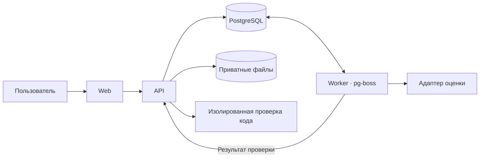
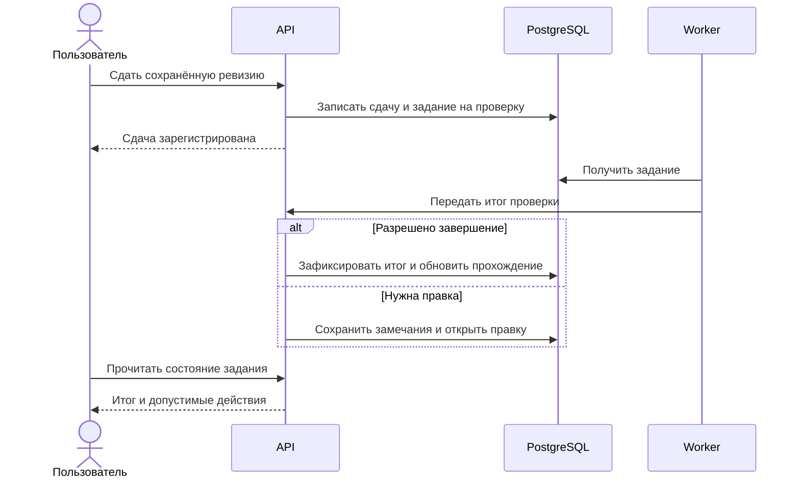

# Системное проектирование

Веб-приложение на Next.js и React использует API на NestJS и Fastify. API организован как модульный монолит. PostgreSQL хранит состояние прохождений и историю работ. Доступ к данным реализован через Drizzle и SQL. Фоновые задачи обслуживает worker с pg-boss. Исполнение пользовательского кода отделено от API и worker, а доступ к приватным файлам проверяет приложение.

Схема показывает ответственность компонентов. Изолированная проверка кода в подходящих заданиях может выполняться до сдачи. Содержательная оценка сдачи проходит через отдельный фоновый контур.

## Контракт пользовательского сценария

Сокращение `{taskPath}` означает `/runtime/runs/:runId/tasks/:taskId`, где `:taskId` — идентификатор версии задания. Для команд изменения состояния нужны сессия и CSRF-токен. Для активации и сдачи используется `Idempotency-Key`.

| Операция | Существенные входные данные | Результат или исключение |
|---|---|---|
| `POST /runtime/activations` | Код профессии, необязательный идентификатор её версии, ключ команды | HTTP 201 и представление прохождения. HTTP 409 при конфликте ключа, отсутствии права или нарушении лимита |
| `GET /runtime/runs/:runId/sequence` | Идентификатор своего прохождения | Текущая и завершённые позиции, обобщённые закрытые позиции |
| `PUT {taskPath}/draft` | `expectedRevision`, `payload` | HTTP 200 и актуальный черновик. HTTP 409 при конфликте ревизии, HTTP 400 при некорректном теле |
| `POST {taskPath}/submit` | `expectedDraftRevision`, ключ команды | HTTP 201 и сохранённая сдача. Повтор той же команды возвращает ту же сдачу, изменение параметров с тем же ключом вызывает конфликт |
| `GET {taskPath}` | Идентификаторы прохождения и версии задания | Состояние, история и разрешённые действия владельца. Для будущего задания прямое чтение возвращает HTTP 404 |

## Проверка работы и переход

В синхронной части сервер проверяет право доступа, ревизию и формальные условия. В фоновом контуре адаптер возвращает структурированную оценку. Итоговый переход разрешает API по правилам задания. Повторный результат не продвигает прохождение дважды. При повторной неопределённости сдача сохраняется для ручного разбора без автоматического принятия. После принятия интерфейс показывает результат текущей работы и ждёт явного действия пользователя для перехода.

## Внешний платёжный контур

Операции внутри PostgreSQL и вызов внешнего провайдера выполняются на разных сторонах интеграции. При неопределённом результате, например при потере ответа, повтор опирается на ту же идентичность операции и сверку состояния. Повторное уведомление об уже обработанном платеже не должно второй раз начислять кредиты. В открытой бете 20 ноября 2026 года покупки были отключены.

Модульный монолит позволяет удерживать местные транзакции в одной системе и упрощает эксплуатацию. Отдельный worker нужен для медленных и повторяемых операций, отдельный runner — для изоляции исполнения. [Схема данных](04-data-and-sql.md) · [Сценарии приёмки](05-quality-assurance.md).
