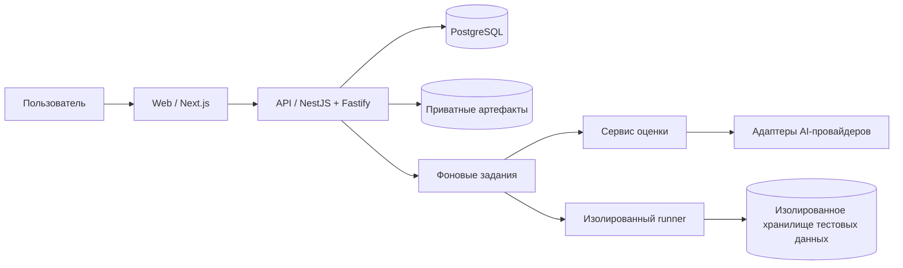
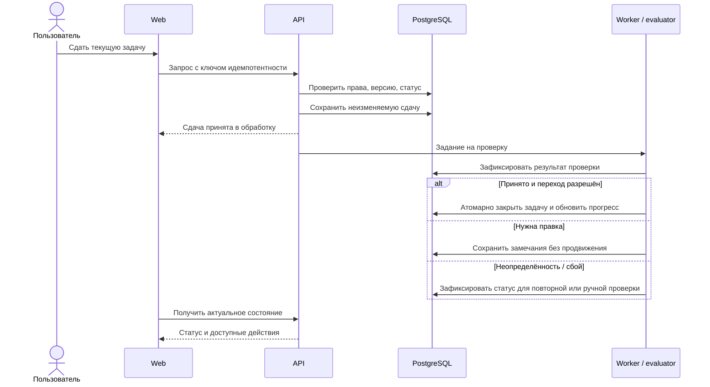

# Системный анализ: архитектура и взаимодействия

**Важно:** схема ниже обзорная. Это не инструкция по развёртыванию, не сетевой план и не гарантия, что каждое запланированное подключение включено в текущей бете.

## Компоненты

Обобщённая структура приватного монорепозитория: `apps/web`, `apps/api`, `apps/worker`, `apps/runner`, общие пакеты `domain`, `contracts`, `ui`. Основной стек: TypeScript, React/Next.js, NestJS/Fastify, PostgreSQL, Drizzle, Docker, pnpm/Turborepo.

## Сквозной сценарий сдачи задания

Это **концептуальная диаграмма**, а не дословная запись всех внутренних методов или HTTP-эндпоинтов.

## Состояния

| Сущность | Основные состояния |
|---|---|
| Прохождение | `ACTIVE`, `PAUSED`, `COMPLETED`, `CANCELLED` |
| Задание | Черновик, отправлено, на оценке, нужна правка, принято / завершено с замечаниями |
| Оценивание | Ожидание, автоматическая проверка, итоговый результат, запрос ручного рассмотрения |

Критический инвариант: **только сервер меняет текущую позицию прохождения**, после проверки требуемых условий. Пауза не должна стирать черновики и историю.

## Границы доверия

1. Web не считается источником истины о доступе, оплате или прохождении.
2. Внешний оценщик выдаёт результат по контракту, но не управляет БД напрямую.
3. Исполнение пользовательского кода вынесено из API/worker в ограниченную среду.
4. Просмотр сохранённых артефактов требует авторизации.
5. Публикация новой версии контента не изменяет историю ранее начатых прохождений.

## Инженерные компромиссы

- **Модульный монолит вместо множества микросервисов:** дешевле координация и эксплуатация на ранней стадии.
- **PostgreSQL как главный источник фактов:** проще обеспечивать транзакционность, аудит и воспроизводимость.
- **Версионирование содержимого:** больше сложность хранения, но нет скрытого изменения заданий посреди прохождения.
- **Детерминированная проверка перед LLM:** дополнительная разработка валидаторов взамен более проверяемых решений.

См. [модель данных и SQL](04-data-and-sql.md) и [тест-дизайн](05-quality-assurance.md).