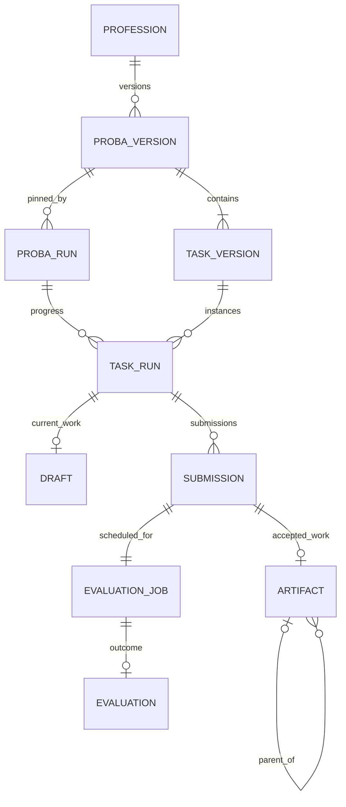

# Модель данных и PostgreSQL

## Какие данные меняются



Кардинальности относятся к прохождению и опубликованному контенту. На схеме опущены попытки обработки задания на проверку, дополнительные связи между артефактами и выдача материалов.

| Данные | Правило целостности |
|---|---|
| `proba_versions`, `task_versions` | Опубликованная версия закреплена за прохождением. Позиция задания уникальна внутри версии |
| `proba_runs`, `task_runs` | Пара прохождение и версия задания уникальна. Составные внешние ключи связывают их с одной версией ПРОБЫ |
| `drafts`, `submissions` | Один изменяемый черновик на задание. Сдача фиксирует его ревизию. Номер попытки и ключ идемпотентности уникальны в рамках задания прохождения |
| `evaluation_jobs`, `evaluations` | Одно задание на оценку на сдачу, не более одной итоговой оценки на задание на оценку. Сохраняются сведения о провайдере, модели и версиях критериев |
| `artifacts` | Принятая работа ссылается на сдачу. Ограничение допускает не более одного артефакта на задание прохождения. Предшественник сохраняет связь между версиями работ |

## Где проходят границы транзакций

При активации сервер сериализует команды одного пользователя. Проверка действующего прохождения, выбор свободного слота, расход права доступа и создание нового прохождения выполняются в одной транзакции. Ограничение по занятым активным слотам поддерживает уникальный индекс. При успешном завершении отдельно фиксируются итог задания, принятый артефакт при его наличии и переход к следующей позиции или завершение прохождения.

## Доля прохождений, завершённых за 14 суток

Пример расчёта для сравнения версий ПРОБЫ. Временная граница задана явно. Включаются только активации, для которых к этой дате прошло 336 часов. Последняя недельная когорта может быть неполной по числу включённых активаций. Часовой пояс недельной группировки — UTC.

```sql
WITH params AS (
    SELECT TIMESTAMPTZ '2026-11-20 00:00:00+00' AS cutoff
),
cohort AS (
    SELECT
        date_trunc('week', r.activated_at AT TIME ZONE 'UTC')::date AS week_utc,
        r.proba_version_id,
        r.completed_at BETWEEN r.activated_at
            AND r.activated_at + INTERVAL '336 hours' AS completed_in_window
    FROM proba_runs AS r
    CROSS JOIN params AS p
    WHERE r.activated_at + INTERVAL '336 hours' <= p.cutoff
)
SELECT
    week_utc,
    proba_version_id,
    COUNT(*) AS eligible_runs,
    COUNT(*) FILTER (WHERE completed_in_window) AS completed_runs,
    ROUND(100.0 * COUNT(*) FILTER (WHERE completed_in_window) / COUNT(*), 1)
        AS completion_pct
FROM cohort
GROUP BY week_utc, proba_version_id
ORDER BY week_utc, proba_version_id;
```

Единица наблюдения — прохождение. Отменённое прохождение остаётся в знаменателе, если окно наблюдения прошло. На смешанном наборе требуется заранее определить, как исключать тестовые аккаунты и технические записи.

## Число сдач на версию задания

```sql
WITH per_task_run AS (
    SELECT tr.task_version_id, COUNT(s.id) AS submission_count
    FROM task_runs AS tr
    LEFT JOIN submissions AS s ON s.task_run_id = tr.id
    GROUP BY tr.id, tr.task_version_id
)
SELECT
    task_version_id,
    COUNT(*) AS task_runs,
    COUNT(*) FILTER (WHERE submission_count = 0) AS without_submission,
    COUNT(*) FILTER (WHERE submission_count > 1) AS with_resubmission,
    MAX(submission_count) AS max_submissions
FROM per_task_run
GROUP BY task_version_id
ORDER BY task_version_id;
```

`LEFT JOIN` включает задания, созданные в прохождении, но ещё ни разу не сданные. Запрос показывает, где смотреть причины повторных сдач. Повторы могут объясняться сложностью задания, замечаниями или обычной работой над правками. Оба примера используют имена столбцов PostgreSQL из проекта. [Проверки и границы доказательств](05-quality-assurance.md).
