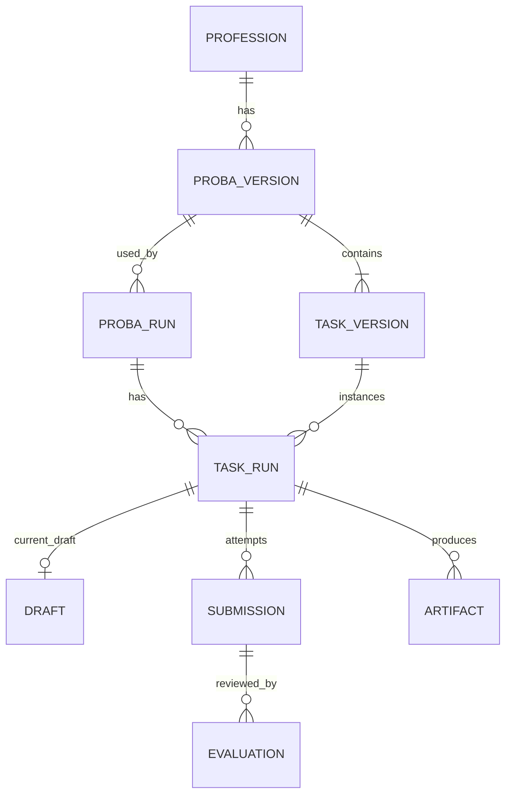

# Модель данных и аналитические SQL-примеры

Документ демонстрирует выделение сущностей, связей, инвариантов и метрик на основе существующей схемы PostgreSQL. Все примеры обезличены; **запросы не выполнялись на пользовательской или production-БД при подготовке портфолио**.

## Логическая ER-модель



В исходной реализации у оценивания дополнительно есть очередь заданий, попытки проверки, версии политик и другие таблицы. Диаграмма специально сокращена для интервью.

## Словарь сущностей

| Сущность | Ответственность | Существенное ограничение |
|---|---|---|
| `proba_versions` | Конкретная опубликованная версия профессии | История не должна переписываться |
| `task_versions` | Версионированные задания | Позиция уникальна внутри версии |
| `proba_runs` | Экземпляр прохождения пользователя | Сервер управляет текущей позицией |
| `task_runs` | Состояние задания в прохождении | Одна задача — один экземпляр в рамках run |
| `drafts` | Текущий редактируемый черновик | Оптимистическая ревизия |
| `submissions` | Неизменяемые попытки сдачи | Ключ идемпотентности и номер попытки |
| `evaluations` | Итоги проверки | Ссылка на сдачу и версии критериев |
| `artifacts` | Принятые результаты | Связь с работой и историей изменений |

## SQL 1: недельные когорты активаций

```sql
-- PostgreSQL. Статусы на момент выполнения запроса.
-- Это демонстрационный срез, НЕ окончательная оценка конверсии.
SELECT
    date_trunc('week', activated_at)::date AS activation_week,
    COUNT(*) AS runs_started,
    COUNT(*) FILTER (WHERE status = 'COMPLETED') AS runs_completed_now,
    ROUND(
        100.0 * COUNT(*) FILTER (WHERE status = 'COMPLETED')
        / NULLIF(COUNT(*), 0), 1
    ) AS completed_share_pct
FROM proba_runs
GROUP BY 1
ORDER BY 1;
```

**Ограничения интерпретации:** новые когорты ещё не успели завершить прохождение; показатель смешивает доступное время, профессию и поведение. Для управленческого вывода нужна единая длительность наблюдения и разделение по версии контента / источнику доступа.

## SQL 2: число попыток на задание

```sql
-- Используются реальные имена таблиц/полей из схемы.
SELECT
    tr.run_id,
    tr.task_version_id,
    COUNT(s.id) AS submission_count,
    MAX(s.attempt_number) AS last_attempt_number
FROM task_runs AS tr
LEFT JOIN submissions AS s
    ON s.task_run_id = tr.id
GROUP BY tr.run_id, tr.task_version_id
ORDER BY tr.run_id, tr.task_version_id;
```

**Зачем:** выделить задания с повторными попытками и проверить гипотезу о неоднозначной постановке или завышенной сложности. Наличие многих попыток само по себе не доказывает плохое качество задания: нужно учитывать причину замечаний и качество обратной связи.

## Правила качества данных

- В аналитике считать повторённые команды один раз по стабильному идентификатору.
- Не включать в продуктовые метрики текст черновиков, содержимое сдач и контактные данные.
- Не трактовать `PAUSED` как отказ от прохождения без дополнительного определения.
- Разделять синтетические тестовые аккаунты и реальные пользовательские когорты.
- Сохранять связь результата с версией задания и проверки.

**Предел демонстрации:** здесь показаны проверяемые SQL-подходы, не реальные бизнес-показатели продукта.